# Meridian · Mechanical Power BI Dashboard

[English](#english) · [简体中文](#中文)

## English

[Download the English edition](meridian-mechanical-bi-en.zip?raw=true)

Meridian is an open-source mechanical-style Power BI cockpit for a simulated cross-border retail business. It follows a year of operations across five markets, three channels and five product categories. Navy instrument panels, chamfered outlines, and cyan chart marks evoke the reference cockpit. Each page uses its own layout and accent to make its main question easy to find.

### Offline HTML preview

Open `preview.html` in your browser after extracting the ZIP. The preview embeds the sample data and artwork in one file. Use the bottom navigation to switch pages and the market and channel filters to compare segments wherever you are in the report.

On the overview map, hover over a market or tab to it to see revenue, orders, and margin. Select a bubble to filter the dashboard and use **Clear market** to return to the full view. Bubble area encodes net revenue, and amber marks the current selection.

The background artwork provides the technical grid, accent lines and instrument panel outlines. SVG charts and HTML tables are rendered over that artwork. Filter changes recompute rates from their numerator and denominator for the selected rows.

### Editable Power BI report

Open `MeridianCockpit.pbip` in Power BI Desktop for Windows. Keep the `.Report` and `.SemanticModel` folders next to the project. If required by your Desktop build, enable Power BI Project or the enhanced report format in **File → Options and settings → Options → Preview features**. On the first open, use **Home → Refresh** if visuals are empty.

The report uses native Power BI visuals, DAX measures and synchronized market and channel slicers. Ctrl-click the on-canvas navigation in Desktop edit mode. The sample table is embedded in the semantic model and refreshes offline. A companion CSV exposes all 900 source rows for inspection.

The overview uses the native **Azure Maps** visual. Its markers cross-filter the KPI cards, trend charts, and market table on that page. Azure Maps needs internet access and may need to be enabled by your Power BI administrator. The HTML map works offline. [Azure Maps setup](https://learn.microsoft.com/azure/azure-maps/power-bi-visual-get-started)

| Page | What it answers |
| --- | --- |
| Operations overview | Where are the five markets, and how do their revenue, order and profit trends compare? |
| Markets & channels | Which channels account for revenue, and how does net revenue per order differ by market? |
| Products & profitability | Which categories produce the most contribution profit? |
| Cross-border fulfillment | Where do late orders and longer transit times concentrate? |
| Refunds & risk | Where do refunds and flagged orders occur most often? |

### Metric definitions and reuse

- Net revenue is gross sales less refunds. Contribution profit subtracts product cost, ad spend and freight from net revenue.
- Refund and flag rates are the relevant order counts divided by total orders. On-time rate is on-time orders divided by orders. Average transit time uses total transit days divided by orders.
- All observations are synthetic, cover January through December 2025, and use USD. A flagged order represents a simulated review signal.
- `design/Meridian-Mechanical.json` can be imported as a Power BI report theme. Page-specific frame PNGs are in `.Report/StaticResources/RegisteredResources/`. The canvas is 1600 × 900.

### Five-page gallery

The following screenshots show the offline HTML preview using the same simulated data.

**Operations overview**

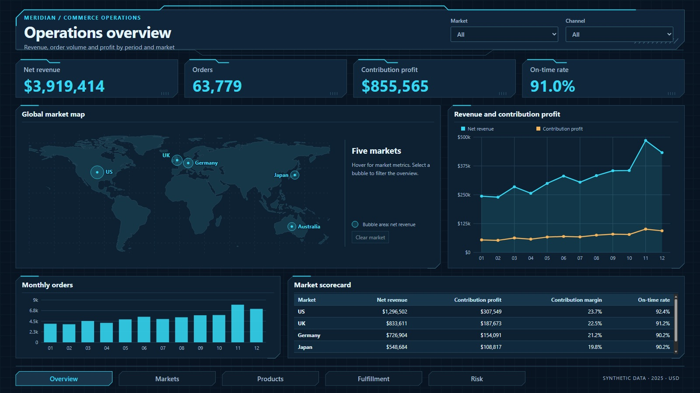

A selected market on the interactive overview map.

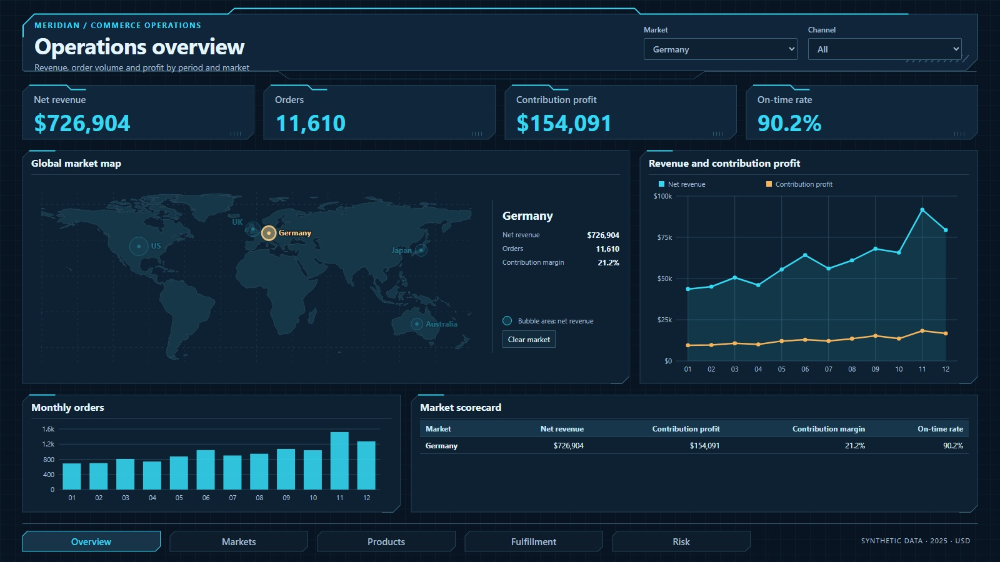

**Markets & channels**

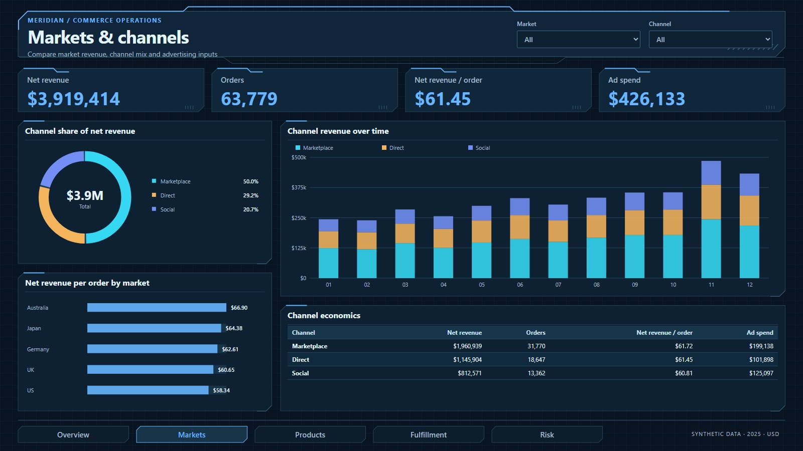

**Products & profitability**

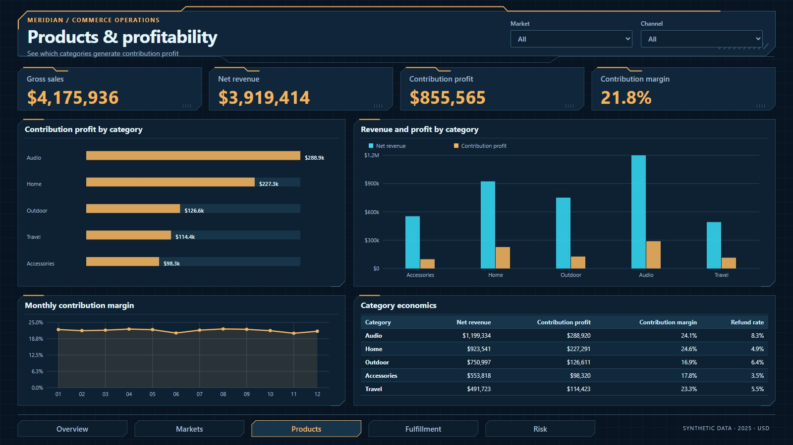

**Cross-border fulfillment**

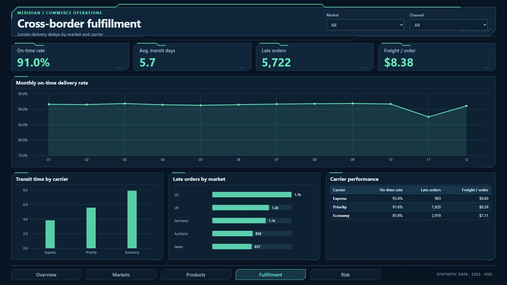

**Refunds & risk**

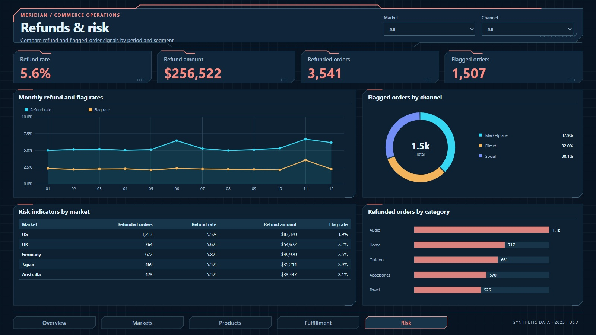

[Visual reference](https://mp.weixin.qq.com/s/sNb0NIlz59H791UmsaCBNw) · [Power BI projects](https://learn.microsoft.com/en-us/power-bi/developer/projects/projects-overview) · [Natural Earth basemap](https://www.naturalearthdata.com/about/terms-of-use/)

## 中文

[下载中文版](meridian-mechanical-bi-zh.zip?raw=true)

Meridian 是一个以模拟跨境电商业务为主题的开源 Power BI 驾驶舱，覆盖五个市场、三个渠道、五个商品类别。视觉取自参考中的深海蓝底色、切角面板和青色仪表线。五页各自采用适合主题的图表组合和强调色。

### 离线 HTML 样片

解压后用浏览器打开 `preview.html`。数据与画布图形已内嵌在一个文件里。用底部页签切换五页，用市场和渠道筛选器对照不同分组。

在首页地图上悬停或用 Tab 聚焦市场气泡，可以查看净销售额、订单量和利润率。点击气泡即可筛选，点击「清除市场」恢复全部市场。气泡面积表示净销售额，琥珀色标示当前选中的市场。

机械底图负责网格、刻线与切角轮廓，上层的 SVG 图表与 HTML 数据表负责呈现数值。切换筛选后，各项比率按当前选中记录重新汇总分子、分母。

### 可编辑的 Power BI 看板

在 Windows 版 Power BI Desktop 中打开 `MeridianCockpit-ZH.pbip`，保留旁边的 `.Report` 和 `.SemanticModel` 文件夹。如果当前版本需要先启用项目或增强报表格式，可在 **文件 → 选项和设置 → 选项 → 预览功能** 中开启。若首次打开图表为空，选择 **主页 → 刷新**。

看板由 Power BI 原生图表、DAX 度量和跨页同步的市场与渠道切片器组成。在 Desktop 编辑模式下按住 Ctrl 点击画布底部导航。模拟数据内嵌在语义模型中，可离线刷新。包内 CSV 另提供 900 行原始数据，供查看和复用。

首页使用 Power BI 原生 **Azure Maps**，点击市场点会交叉筛选首页指标卡、趋势图与市场表。Azure Maps 需要联网，组织环境可能需要管理员启用。HTML 地图可离线使用。[Azure Maps 设置](https://learn.microsoft.com/zh-cn/azure/azure-maps/power-bi-visual-get-started)

| 页面 | 能回答的问题 |
| --- | --- |
| 经营总览 | 五个市场分布在哪里，各自的净销售额、订单量和利润趋势如何？ |
| 市场与渠道 | 哪些渠道贡献了收入？不同市场的每单净收入差异多大？ |
| 商品与利润 | 哪些商品类别贡献的利润最多？ |
| 跨境履约 | 延误订单和较长运输耗时集中在哪里？ |
| 退款与风险 | 哪些分组的退款和订单标记较多？ |

### 指标口径与样式复用

- 净销售额为成交总额扣除退款。贡献利润继续扣除商品成本、广告投入和运费。
- 退款率、标记率和准时率，以相应的订单量除以总订单量。平均运输天数为累计运输天数除以总订单量。
- 数据均为模拟，覆盖 2025 年 1 月至 12 月，金额单位为美元。标记订单表示模拟的待复核信号。
- 可将 `design/Meridian-Mechanical.json` 导入 Power BI 作为主题。五页的 PNG 底图位于 `.Report/StaticResources/RegisteredResources/`，画布为 1600 × 900。

### 五页预览

以下是离线 HTML 样片实拍，数据与 Power BI 项目一致。

**经营总览**

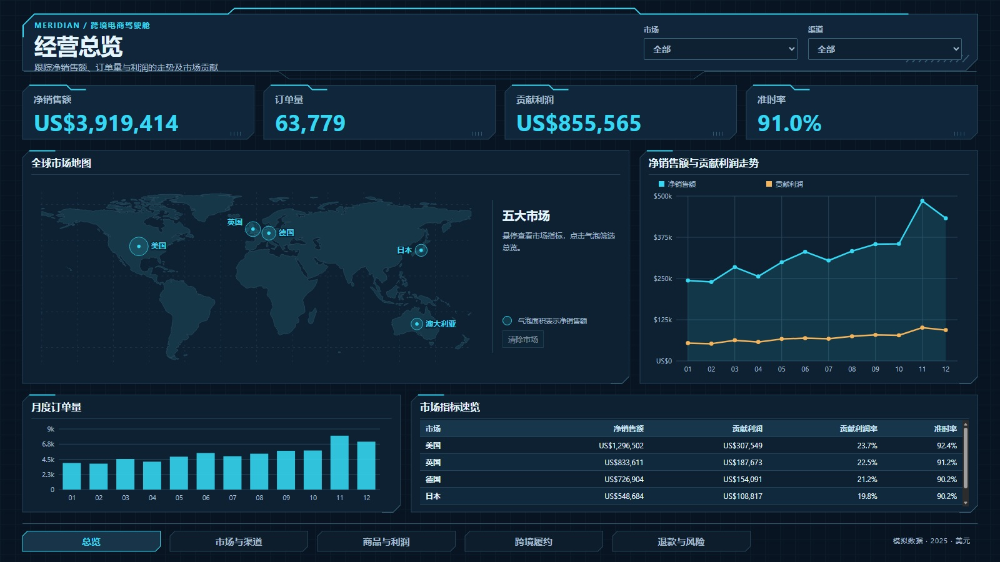

首页地图选中市场后的联动效果。

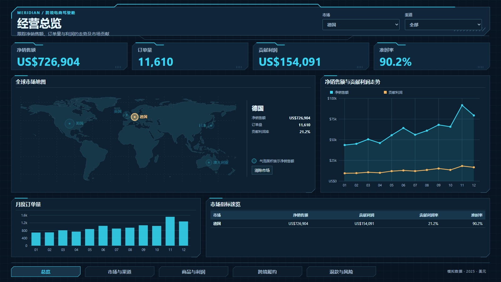

**市场与渠道**

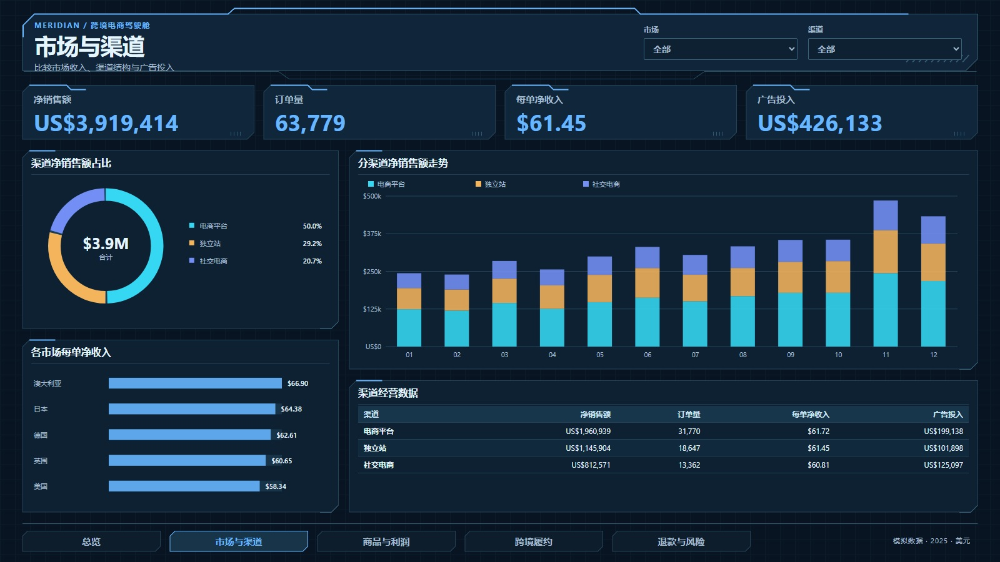

**商品与利润**

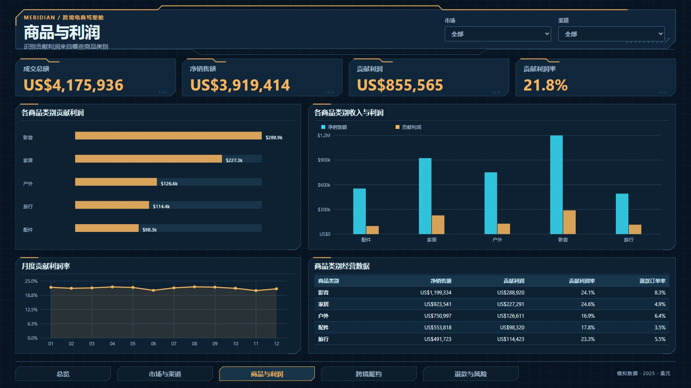

**跨境履约**

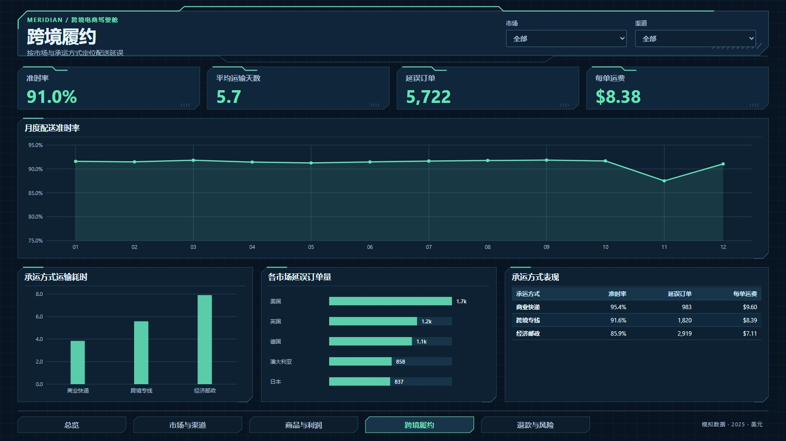

**退款与风险**

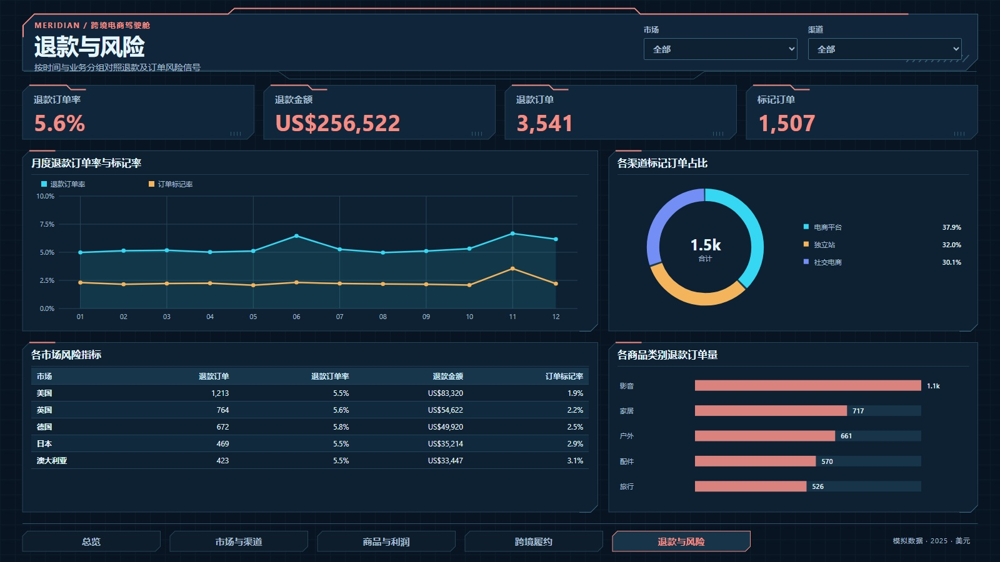

[视觉参考原文](https://mp.weixin.qq.com/s/sNb0NIlz59H791UmsaCBNw) · [Power BI 项目文档](https://learn.microsoft.com/en-us/power-bi/developer/projects/projects-overview) · [Natural Earth 底图](https://www.naturalearthdata.com/about/terms-of-use/)

## License / 许可

Original project files, artwork and sample data are released under the [MIT License](LICENSE).

原创项目文件、设计图形和模拟数据采用 [MIT 许可](LICENSE)。
